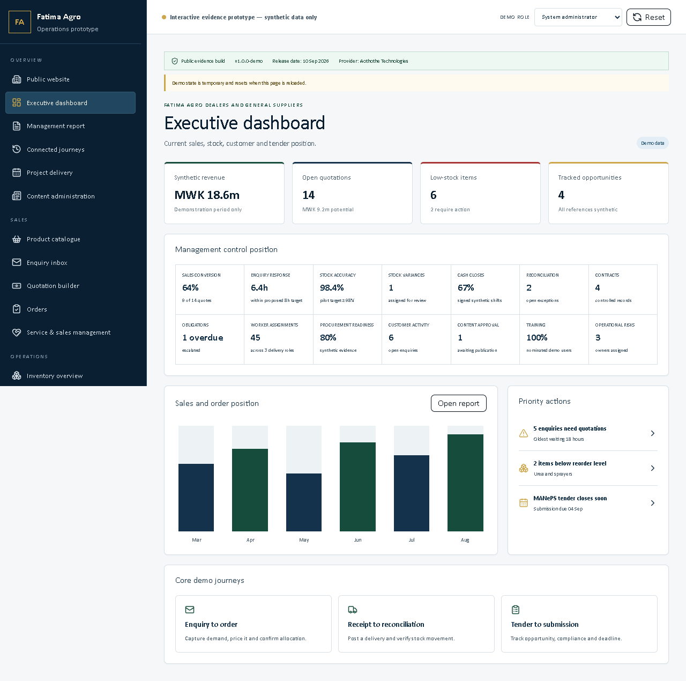

# Fatima Agro Digital Operations Demo

A public, synthetic-data interactive concept and evidence prototype for Fatima Agro Dealers and General Suppliers, with a location reference of Kanengo, Lilongwe. The demonstration was prepared by Aothothe Technologies.

> This is not production software. Every customer, worker, price, stock quantity, balance, transaction, receipt, contract, procurement reference, performance result and dashboard figure is synthetic.

## Live evidence demo

[Open the hosted demo](https://fatima-agro-operations-demo.peterschrispine.chatgpt.site)

Use the role switcher in the header. It provides safe synthetic views for customer, seller, storekeeper, content editor, finance officer, supervisor, manager, system administrator and agent/dealer roles. It is an authorization demonstration, not real authentication. Temporary state can be reset at any time.

## Responsive release evidence



The same release candidate is captured and tested at [tablet](docs/screenshots/dashboard-tablet.png) and [mobile](docs/screenshots/dashboard-mobile.png) sizes. These images contain only synthetic demonstration records.

## Purpose

The project demonstrates how public product discovery can connect to controlled customer service, sales, stock, cash, procurement, content and management workflows. It is designed for evaluation, requirements validation, training discussion and release-evidence review.

The prototype does not verify or claim Fatima’s legal registration, tax position, licences, certifications, product approvals, management titles or signing authority.

## Portal and feature matrix

| Area | Demonstrated capabilities |
| --- | --- |
| Public website | Homepage, categories, searchable catalogue, product detail, enquiry, how-to-buy, stories, contact/location boundary, privacy, terms, consent controls, mobile navigation and metadata |
| Customer portal | Own-record dashboard, profile/contact verification state, enquiries, quotations, acceptance/amendment path, orders, fulfilment instructions, receipts, approved statements, support, preferences, consent history, privacy requests and session controls |
| Worker/seller portal | Shift and sales point, opening float, stock search, POS, numbered receipts, payment method, discount/refund boundaries, daily report, cash count/variance, supervisor close, tasks, follow-ups, stock counts, targets and CSV export |
| Customer service & sales | Enquiry assignment, response-time tracking, quotation builder, pricing approval, orders, reservations, CRM, reminders, customer history, conversion and escalation |
| Inventory & procurement | Products, pack sizes, units, locations, opening balances, goods received, transfers, reservations, adjustments, physical counts, reconciliation, reorder levels, suppliers, requests, orders, delivery evidence, opportunities and compliance readiness |
| Finance & reconciliation | Receipts, cashbook, expenses/evidence, daily close, deposit batches, statement-import demonstration, matching, exceptions, approval, totals, period reports, CSV export and audit trail |
| Contracts, tasks & admin | Contract register, status, obligations, owners/approvers, dates, evidence, assignments, dependencies, escalations, decisions, risks/issues, changes, approvals and closeout records |
| Content administration | Pages, stories, products, categories, media/SEO, drafts, review, schedule, approval, publication, correction, emergency unpublish pattern, archive/restore, controlled deletion and versions |
| Management dashboard | Synthetic revenue, conversion, response time, stock, cash close, reconciliation, contracts, obligations, workers, procurement, customers, content, training, risks and export |
| System administration | RBAC, users/roles, permission matrix, separation of duties, authentication-state demo, sessions, audit, export controls, backup/restore procedure, incidents, privacy requests, retention, environment, release and health |
| Agent/dealer expansion | Future-capability onboarding, territory, product access, ordering, margin illustration, performance, support, document readiness and independent approval |

## Connected demonstration journeys

1. Visitor → unique enquiry → staff assignment → quotation → customer acceptance → synthetic order.
2. Seller → numbered receipt → cash count → supervisor close → deposit batch → finance reconciliation.
3. Supplier delivery → goods received → stock update → physical count → reconciliation.
4. Manager task → worker completion → evidence → independent approval.
5. Contract → obligation → owner → due date → evidence → management review.
6. Content draft → reviewer approval → publication → correction → archive/version history.
7. Customer role → quotation → receipt/statement → support or privacy request.
8. Agent/dealer applicant → readiness review → approval decision.

## Architecture

The application is a strongly typed React/TypeScript interface built with Next-compatible routing through Vinext and Vite, packaged for the configured OpenAI Sites/Cloudflare Worker runtime. The public release uses no database, upload store, bank connection or runtime secret. Workflow state is temporary browser-session state.

```text
Public pages + role switcher
          ↓
Typed React portal screens
          ↓
Synthetic workflow state + separation-of-duties rules
          ↓
Vinext/Vite build → Cloudflare Worker-compatible Sites artifact
```

See [docs/ARCHITECTURE.md](docs/ARCHITECTURE.md) for the control boundaries and [docs/FEATURE_MATRIX.md](docs/FEATURE_MATRIX.md) for detailed coverage.

## Local setup

Requirements: Node.js 22.13 or later and npm.

```bash
npm ci
npm run dev
```

Open the local URL printed by Vite. No environment variables are required. Copy `.env.example` only if you need to exercise the documented non-secret release metadata pattern.

## Verification

```bash
npm run lint
npm run typecheck
npm test
npm run build
npm run test:components
npx playwright install chromium
npm run test:browser
npm run audit:prod
npm run scan:secrets
```

CI runs linting, type checking, unit/workflow/release-boundary tests, production build, component tests, three responsive browser profiles, production dependency audit and secret scanning. See the [v1.0.0-demo release evidence](docs/RELEASE_EVIDENCE.md) for the gate record and screenshots.

## Public-data and security boundary

- Do not enter real names, phone numbers, email addresses, identity records, addresses, employee data, bank details, credentials, agreements, prices or procurement records.
- No real bank account is connected. The sequence shown is statement import, then separately approved read-only feed, then separately authorized payment initiation only under production controls.
- Online-banking passwords must never be requested or stored.
- Destructive actions are disabled. Other actions affect only temporary synthetic browser state.
- Customers are limited to the synthetic records assigned to their demonstration account.
- Sellers cannot approve their own cash variance, refund or stock adjustment.
- Commercial, legal, regulated and product claims require a second reviewer.
- Private client/legal packs, negotiations and readiness responses are excluded from this repository.

Report suspected security issues privately as described in [SECURITY.md](SECURITY.md).

## Deployment

The repository is configured for OpenAI Sites through `.openai/hosting.json`. A release build is saved against an exact Git commit and then deployed. Access is made public only for the sanitized evidence demo. Custom domains and DNS are outside this release.

See [docs/DEPLOYMENT.md](docs/DEPLOYMENT.md) for build, release, health and rollback steps.

## Known limitations

- Authentication, persistent user accounts and server-side authorization are demonstrated, not connected to a real identity provider.
- Data resets with the browser session and is not shared between visitors.
- Forms do not send email, SMS or WhatsApp messages.
- Product, stock, price, location and availability values are illustrative until formally verified.
- Receipts and statements are demonstration downloads, not fiscal or banking records.
- No live MANePS, supplier, payment, accounting, bank, map, analytics or messaging integration is connected.
- Agent/dealer features describe a possible future capability, not an operating network.

## Deferred production integrations

Identity and MFA; server-side RBAC; encrypted durable storage; verified customer/product/stock migration; notifications; fiscal/POS integration; accounting; approved business-bank statement import; supported read-only bank feed; separately authorized payment initiation with secure tokens, MFA, limits and dual approval; backups; monitoring; incident response; and verified legal/privacy/retention controls.

## Contributing

Review [CONTRIBUTING.md](CONTRIBUTING.md). Do not open an issue or pull request containing client data, credentials, private documents or unverified claims.

## Copyright and evaluation notice

Copyright © 2026 Aothothe Technologies. All rights reserved.

This source is published for evaluation only. Publication does not grant commercial reuse, redistribution, sublicensing or production-operation rights. No open-source licence is granted unless Aothothe Technologies approves and publishes a separate licence.
